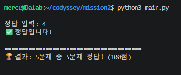
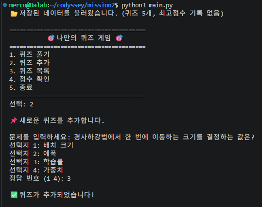
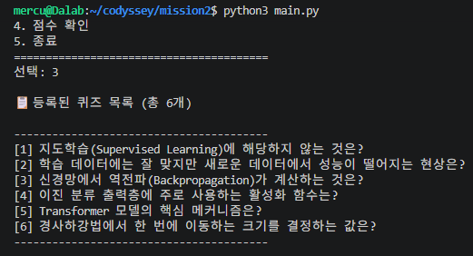
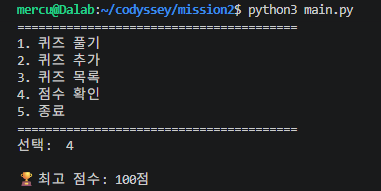
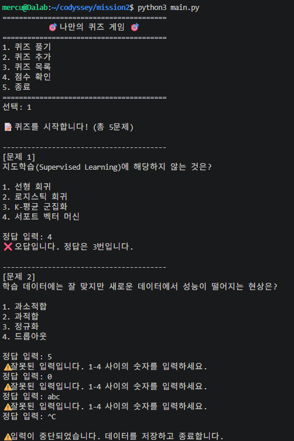
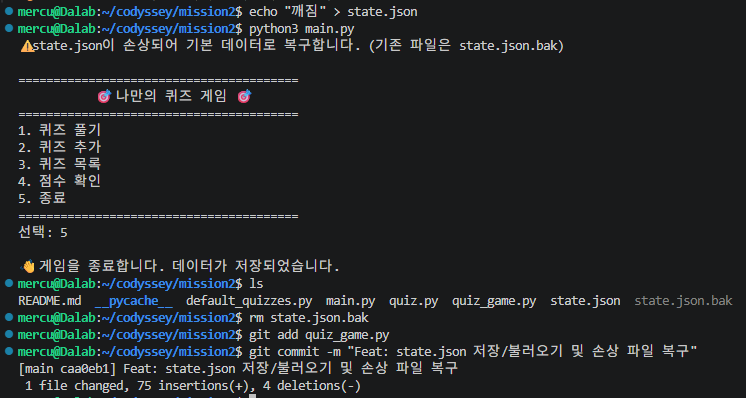
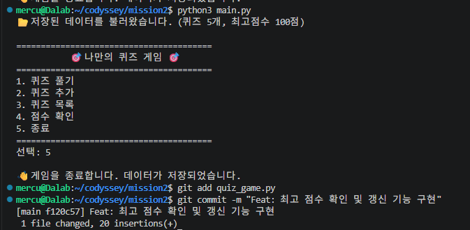
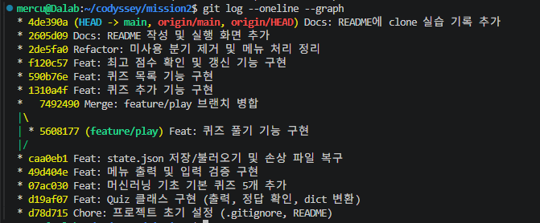

# 🎯 머신러닝 기초 퀴즈 게임

터미널에서 동작하는 4지선다 퀴즈 게임입니다. 퀴즈를 풀거나 새로 추가할 수 있고, 퀴즈 목록과 최고 점수는 `state.json`에 저장되어 프로그램을 다시 실행해도 유지됩니다.

## 퀴즈 주제 및 선정 이유

- **주제**: 머신러닝 기초 (지도학습, 과적합, 역전파, 활성화 함수, Transformer)
- **선정 이유**: 인공지능 전공자로서 자주 쓰지만 정확히 설명하기는 어려운 핵심 개념을 문제로 만들어 스스로 점검하기 위해 선정했습니다.

## 실행 방법

- Python 3.10 이상 (외부 라이브러리 없음, 개발 환경: Python 3.14.4 / WSL Ubuntu)

```bash
git clone https://github.com/mercury0925/mission2.git
cd mission2
python3 main.py
```

## 기능 목록

| 메뉴 | 기능 |
|---|---|
| 1. 퀴즈 풀기 | 등록된 퀴즈를 순서대로 출제하고 정답/오답을 바로 알려줌. 끝나면 100점 만점 점수를 표시하고 최고 점수를 갱신. 퀴즈가 없으면 안내 |
| 2. 퀴즈 추가 | 문제, 선택지 4개, 정답 번호를 입력받아 추가하고 즉시 저장 |
| 3. 퀴즈 목록 | 등록된 문제 목록 출력. 퀴즈가 없으면 안내 |
| 4. 점수 확인 | 최고 점수 출력. 아직 푼 기록이 없으면 안내 |
| 5. 종료 | 데이터를 저장하고 종료 |

**입력 및 예외 처리**

- 숫자 입력은 앞뒤 공백을 제거한 뒤 처리하고, 빈 입력·숫자가 아닌 값·범위 밖 숫자는 안내 후 다시 입력받음
- 문제·선택지에 빈 값이 들어오면 다시 입력받음
- `Ctrl+C`(KeyboardInterrupt), 입력 종료(EOFError) 시 저장 후 안전하게 종료
- 저장은 임시 파일에 먼저 쓴 뒤 교체(`os.replace`)하여, 쓰는 도중 실패해도 기존 파일이 손상되지 않음

## 파일 구조

```
mission2/
├── main.py              # 프로그램 진입점
├── quiz.py              # Quiz 클래스
├── default_quizzes.py   # 기본 퀴즈 5개
├── quiz_game.py         # QuizGame 클래스
├── docs/screenshots/    # 실행 화면 및 개발 과정 기록
├── .gitignore
└── README.md
```

| 클래스 | 속성 | 주요 메서드 |
|---|---|---|
| `Quiz` | `question`, `choices`, `answer` | `display` 출력, `is_correct` 정답 확인, `to_dict` / `from_dict` JSON 변환 및 형식 검증 |
| `QuizGame` | `quizzes`, `best_score`, `state_file` | `show_menu`, `play`, `add_quiz`, `list_quizzes`, `show_score`, `update_best_score`, `load` / `save`, `input_number` / `input_text` |

**클래스로 나눈 이유**

- **데이터와 동작을 묶기 위해**: 퀴즈 하나의 문제·선택지·정답과 이를 다루는 동작(출력, 정답 확인)을 `Quiz`에 묶어, 함수와 dict만 쓸 때처럼 `quiz["answer"]` 같은 접근이 코드 곳곳에 흩어지지 않게 했습니다.
- **역할 분리**: `Quiz`는 "퀴즈 한 개", `QuizGame`은 "게임 전체(목록, 점수, 메뉴, 저장)"만 책임지므로, 저장 방식을 바꿔도 `Quiz`는 수정할 필요가 없습니다.
- **상태 공유**: 퀴즈 목록과 최고 점수를 `self`의 속성으로 두어, 모든 메서드가 전역 변수나 매개변수 전달 없이 같은 상태를 사용합니다.
- **한계**: 이 정도 규모에서는 함수만으로도 구현할 수 있어 코드가 다소 길어지지만, 기능이 늘어날수록(힌트, 삭제, 기록 등) 수정 범위를 줄일 수 있습니다.

## 데이터 파일 (state.json)

- **경로**: 프로젝트 루트 `state.json` (UTF-8)
- **역할**: 퀴즈 목록과 최고 점수 저장. 실행 중 생성되는 데이터라 `.gitignore`로 저장소에서 제외
- **파일이 없을 때**: 기본 퀴즈 5개로 새로 생성
- **파일이 손상됐을 때**: 안내 메시지 출력 후 `state.json.bak`으로 백업하고 기본 데이터로 복구

| 키 | 타입 | 설명 |
|---|---|---|
| `quizzes` | list | 퀴즈 목록 |
| `quizzes[].question` | str | 문제 |
| `quizzes[].choices` | list[str] | 선택지 4개 |
| `quizzes[].answer` | int | 정답 번호 (1~4) |
| `best_score` | int \| null | 최고 점수(100점 만점), 기록이 없으면 `null` |

```json
{
  "quizzes": [
    {
      "question": "경사하강법에서 한 번에 이동하는 크기를 결정하는 값은?",
      "choices": ["배치 크기", "에폭", "학습률", "가중치"],
      "answer": 3
    }
  ],
  "best_score": 100
}
```

**JSON을 사용한 이유와 한계**

| 구분 | 내용 |
|---|---|
| 장점 | 사람이 바로 읽고 수정할 수 있는 텍스트 형식이며, Python의 `list`/`dict`와 구조가 그대로 대응해 표준 라이브러리 `json`만으로 저장·복원이 가능 |
| 한계 | 일부만 수정해도 파일 전체를 다시 쓰고, 읽을 때도 전체를 메모리에 올림. 데이터가 커지면 느려지고, 여러 프로그램이 동시에 쓰면 충돌할 수 있음 |
| 대안 | 데이터가 많아지면 SQLite(`sqlite3`, 표준 라이브러리)처럼 필요한 행만 읽고 쓰는 DB나, 한 줄에 레코드 하나씩 추가하는 JSON Lines 형식을 고려 |

퀴즈 수십 개 수준에서는 JSON으로 충분하다고 판단했고, 쓰는 도중 중단될 위험은 임시 파일 저장 후 교체하는 방식으로 보완했습니다.

## 실행 화면

| 퀴즈 풀기 | 퀴즈 추가 |
|---|---|
|  |  |

| 퀴즈 목록 | 점수 확인 |
|---|---|
|  |  |

| 잘못된 입력 · Ctrl+C | 손상 파일 복구 | 재실행 후 데이터 유지 |
|---|---|---|
|  |  |  |

## 개발 과정 및 Git 기록

기능 단위로 커밋했고, 퀴즈 풀기는 `feature/play` 브랜치에서 구현한 뒤 `--no-ff`로 병합했습니다. 개발이 끝난 뒤 별도 디렉터리에 clone해서 README를 수정·push하고, 원래 디렉터리에서 pull로 반영된 것을 확인했습니다.

**커밋 메시지 규칙**: `타입: 변경 요약` 형식으로, 한 커밋에는 기능 하나만 담았습니다.

| 타입 | 용도 |
|---|---|
| `Feat` | 새 기능 추가 |
| `Fix` | 버그 수정 |
| `Refactor` | 동작 변경 없는 코드 구조 정리 |
| `Docs` | README, 스크린샷 등 문서 |
| `Chore` | 초기 설정 등 기타 작업 |

**커밋 로그** (`git log --oneline --graph`, 총 14개)

```
* 2686625 Docs: Git 실습 스크린샷 추가
* 4de390a Docs: README에 clone 실습 기록 추가
* 2605d09 Docs: README 작성 및 실행 화면 추가
* 2de5fa0 Refactor: 미사용 분기 제거 및 메뉴 처리 정리
* f120c57 Feat: 최고 점수 확인 및 갱신 기능 구현
* 590b76e Feat: 퀴즈 목록 기능 구현
* 1310a4f Feat: 퀴즈 추가 기능 구현
*   7492490 Merge: feature/play 브랜치 병합
|\
| * 5608177 Feat: 퀴즈 풀기 기능 구현
|/
* caa0eb1 Feat: state.json 저장/불러오기 및 손상 파일 복구
* 49d404e Feat: 메뉴 출력 및 입력 검증 구현
* 07ac030 Feat: 머신러닝 기초 기본 퀴즈 5개 추가
* d19af07 Feat: Quiz 클래스 구현 (출력, 정답 확인, dict 변환)
* d78d715 Chore: 프로젝트 초기 설정 (.gitignore, README)
```



| 단계 | 기록 |
|---|---|
| 개발 환경 (Python, Git 설정) | [01-env](docs/screenshots/01-env.png) |
| 저장소 생성 · 첫 push | [02-init-push](docs/screenshots/02-init-push.png) |
| Quiz 클래스 · 기본 퀴즈 · 메뉴 커밋 | [03](docs/screenshots/03-commit-quiz.png) · [04](docs/screenshots/04-commit-default-quizzes.png) · [05](docs/screenshots/05-commit-menu.png) |
| state.json 생성 · 불러오기 | [06-first-run](docs/screenshots/06-first-run.png) · [07-reload](docs/screenshots/07-reload.png) |
| 브랜치 생성 · 병합 | [10-branch-merge](docs/screenshots/10-branch-merge.png) |
| 퀴즈 추가 후 파일 저장 확인 | [12-add-quiz-saved](docs/screenshots/12-add-quiz-saved.png) |
| 목록 · 리팩터링 커밋 | [13](docs/screenshots/13-commit-list.png) · [15](docs/screenshots/15-refactor-push.png) |
| clone · pull 실습 | [19-clone](docs/screenshots/19-clone.png) · [20-pull](docs/screenshots/20-pull.png) |
> clone 실습: 별도 디렉터리(mission2-clone)에서 수정 후 push
